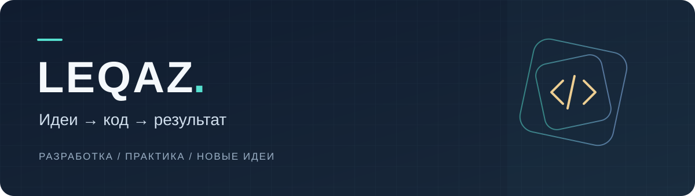

### Привет, я LEQAZ

Изучаю разработку и создаю практические проекты. Интересуюсь вебом, автоматизацией и инструментами ИИ — пробую разные направления и постепенно собираю портфолио.

Мне нравится превращать идею в понятный, работающий результат: продумывать интерфейс, разбираться в деталях и проверять, как всё работает на практике.

### Сейчас в работе

- Практика **HTML, CSS и JavaScript** на собственных проектах.
- Работа с **Git и GitHub**: исходники, версии и публикация.
- Изучение **автоматизации и ИИ-инструментов** для повседневных задач.

### Первый проект

**[ЛЕГКО](https://github.com/LEQAZ/legko-cleaning)** — учебный веб-проект с двумя страницами, адаптивным оформлением и интерактивным калькулятором. Есть подробная расшифровка стоимости, сохранение выбора между страницами и автоматические тесты.

[Открыть сайт ↗](https://leqaz.github.io/legko-cleaning/) · [Смотреть презентацию ↗](https://leqaz.github.io/legko-cleaning/presentation.html) · [Посмотреть код ↗](https://github.com/LEQAZ/legko-cleaning)

 

---

В проектах использую ИИ как помощника. В описаниях отмечаю свой вклад, возможности и ограничения результата.
